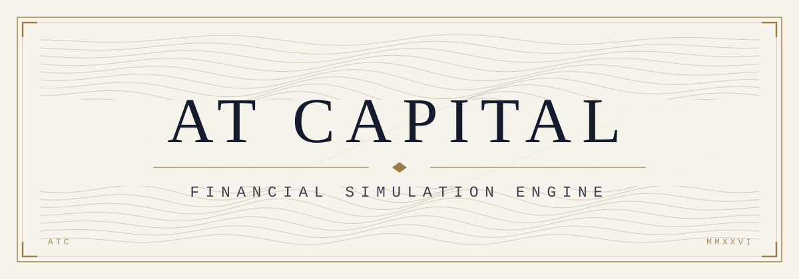

<picture>
  <source media="(prefers-color-scheme: dark)" srcset="docs/img/banner-dark.svg">
  <source media="(prefers-color-scheme: light)" srcset="docs/img/banner-light.svg">
  
</picture>

 

  <b>A U T O N O M O U S &nbsp;&nbsp; T R A D E</b>
  &nbsp;·&nbsp;
  <b>C A P I T A L</b>
  &nbsp;·&nbsp;
  <b>E N G I N E</b>

  

  

<samp>ATC &nbsp;·&nbsp; MMXXVI</samp>

